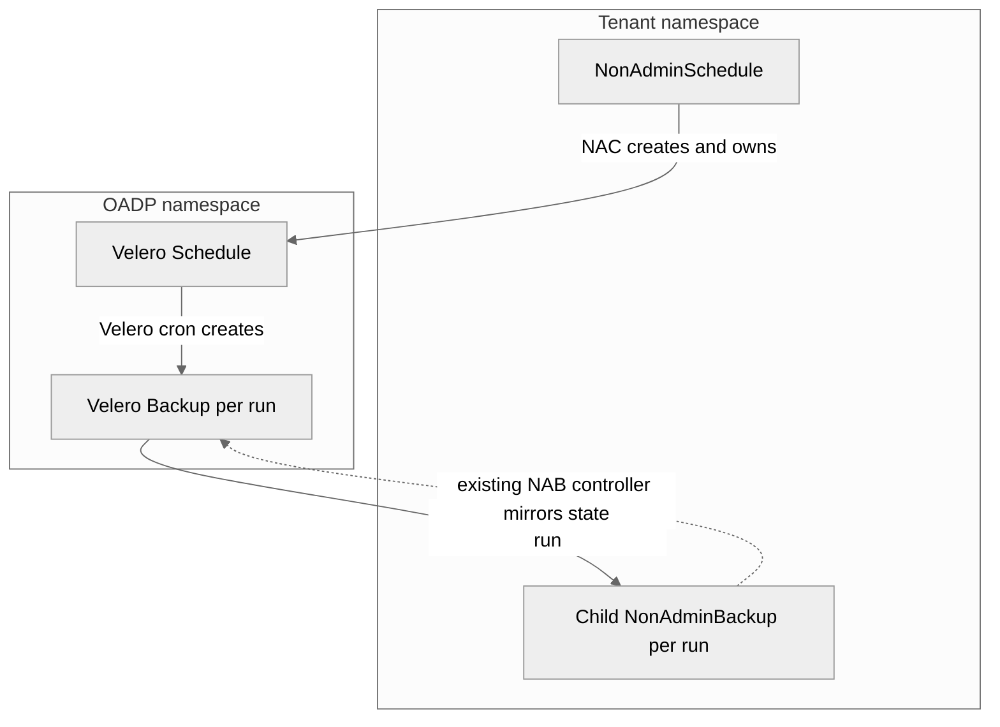

# NonAdminSchedule design `tenant self-service scheduled backups`

_Note_: The preferred style for design documents is one sentence per line.
*Do not wrap lines*.

## Abstract

This proposal adds a namespaced `NonAdminSchedule` (NAS) API that gives a non-admin tenant self-service scheduled backups inside its own namespace.
The Non Admin Controller (NAC) validates the schedule template, creates one backing Velero `Schedule` in the OADP namespace, and surfaces every generated Velero `Backup` as a synchronized `NonAdminBackup` (NAB) in the tenant namespace.

## Background

OADP ships a non-admin feature that lets a tenant run one-off backups and restores in its own namespace through `NonAdminBackup`, `NonAdminRestore`, and `NonAdminBackupStorageLocation`, governed by the `NonAdmin` section of the `DataProtectionApplication` (DPA) spec.
Tenants want recurring backups without asking a cluster administrator to create a Velero `Schedule` for them.
Velero `Schedule` objects live in the OADP namespace, which tenants cannot access, so NAC must own the backing object and mediate every interaction, the same pattern already used for `NonAdminBackup` and its backing Velero `Backup`.

## Goals

- A namespaced `NonAdminSchedule` API that a tenant fully controls in its own namespace.
- Reuse the existing non-admin validation, namespace isolation, NABSL resolution, exclusion rules, and DPA enforced backup spec.
- Surface each generated Velero `Backup` as a child `NonAdminBackup` so the existing backup and restore flows work unchanged.

## Non Goals

- Cross-cluster non-admin restore.
- Individual file restore.
- Tenant control over backing object metadata.

## High-Level Design

The tenant owns the `NonAdminSchedule`.
NAC owns the backing Velero `Schedule` and every label, annotation, and ownership marker on it.
Velero owns cron execution, per backup TTL retention, pause and resume, and skipping the next run.
NAC is the single owner of the generated backups' tenant-facing lifecycle: it creates exactly one child NAB per run and reaps that child when the backing backup is gone.

## Detailed Design

### API

`NonAdminSchedule.spec` contains:

- `schedule`: a standard Velero cron expression.
- `paused`: stops or resumes future executions.
- `skipImmediately`: skips the next scheduled execution. This is an edge trigger and NAC resets it after Velero accepts it.
- `template.backupSpec`: the complete existing Velero `BackupSpec` surface.

Tenant controlled template metadata is intentionally not honored.
Velero copies a schedule template's metadata labels onto every generated `Backup` when they are set, in place of the backing Schedule's own labels, so honoring tenant metadata would let a tenant overwrite the NAC ownership labels that the whole model depends on.
The API exposes the full Velero `BackupSpec`, which embeds `metadata`, so the controller cannot block this structurally.
NAC therefore clears `template.backupSpec.metadata` while building the backing template, which forces Velero to inherit the Schedule's NAC owned labels.

`NonAdminSchedule.status` exposes the backing Velero `Schedule` state, the next calculated run, the latest generated backup, and the five newest generated child backups.

### DPA integration

NAS reuses the existing `NonAdmin` DPA configuration with no new DPA fields.

- `spec.nonAdmin.enforceBackupSpec` applies to schedule templates exactly as it applies to a `NonAdminBackup`. An administrator enforced field that conflicts with the template is rejected, and an enforced field the tenant left empty is defaulted.
- `spec.nonAdmin.backupSyncPeriod` and the garbage collection period continue to gate the periodic synchronizer and the garbage collector. The NAS ownership rules below hold whether or not those two controllers are enabled.

### Operator deployment

The operator deploys the non-admin feature through the non-admin controller image.
Adding NAS requires the operator to ship the new `NonAdminSchedule` CRD and the user-facing RBAC (admin, editor, viewer) for it, the same way it ships the existing non-admin CRDs.
No new operator configuration surface is introduced.

### Backing Schedule naming and the label value budget

NAC allocates a NACUUID for the schedule and uses it as the backing Velero `Schedule` name.
Velero names each generated `Backup` as `<scheduleName>-<timestamp>` where the timestamp is a fixed 15 character suffix.
NAC reuses that generated backup name as the value of the `nab-synced-from-nacuuid` and `nab-origin-nacuuid` labels on the child NAB and the backing Backup.
Kubernetes caps a label value at 63 characters.
Therefore the schedule NACUUID must be at most 48 characters so every generated backup name stays a valid label value.
NAC allocates the schedule NACUUID with a 48 character bound while keeping the full UUID portion for uniqueness.

### Validation and template enforcement

On each reconcile NAC builds a throwaway NAB from `template.backupSpec` and runs the same validation used by `NonAdminBackup`.
This enforces namespace isolation (`includedNamespaces` may contain only the tenant namespace, `excludedNamespaces` is forbidden), forbids cluster scoped escalation, and resolves `storageLocation` to a tenant NABSL that is `Created` and backed by an `Available` Velero BSL.
NAC also rejects an invalid cron expression before creating anything.

After validation NAC builds the backing template: merge DPA enforced fields into empty template fields, force `includedNamespaces` to the tenant namespace, resolve the tenant NABSL to the real Velero BSL for the backing object while recording the tenant facing NABSL name for the child NAB, append the always excluded resource lists, and clear the template metadata.

### Concurrency and Ownership

Velero copies the backing `Schedule` labels onto every generated `Backup`, so generated backups carry the NAC labels and would otherwise match the selectors of two other controllers:

- The periodic `NonAdminBackupSynchronizer`, which creates a NAB for any completed NAC labeled backup whose origin NAB does not yet exist.
- The garbage collector, which deletes any NAC labeled backup that carries origin metadata but has no backing NAB.

Without coordination these create two failure modes in the window between NAC stamping origin metadata on a generated backup and NAC creating its child NAB.
The synchronizer could create the child NAB first, without the NAS ownership label, so NAC's reaper could never clean it up.
The garbage collector could delete the tenant's generated backup as a presumed orphan.

Ownership rule: a Velero `Backup` that carries both the Velero schedule-name label and the NAS origin NACUUID label is a schedule generated backup and is owned exclusively by the NonAdminSchedule controller.

- The synchronizer skips these backups and never creates child NABs for them.
- The garbage collector skips these backups, because retention is governed by Velero TTL, not orphan collection.
- The NonAdminSchedule controller is the only creator and the only reaper of schedule child NABs.

NAC never sets `template.metadata.labels`, which keeps Velero inheriting the Schedule's NAC owned labels. This invariant is covered by a test.

### Status, deletion, and retention

NAC mirrors the backing Velero `Schedule` status, computes the next run from the cron expression and the later of the last backup and last skipped times, and records the five newest generated child backups.

Deleting a `NonAdminSchedule` deletes the backing Velero `Schedule`, which stops future runs, and retains already created child NABs and their Velero `Backup` objects until their TTL expires or the tenant deletes a child NAB.
Child NAB cleanup must survive `NonAdminSchedule` deletion, because the schedule may be deleted long before its retained backups expire.
The NonAdminBackup controller owns the reap through its existing Velero `Backup` watch: when a schedule child NAB (identified by the `nas-origin-nacuuid` label) that has already reached the `Created` phase finds its backing Velero `Backup` gone, the controller deletes the child, independently of the NonAdminSchedule and of the garbage collector.
Requiring the `Created` phase confirms the child synced at least once, so a transient cache miss cannot trigger a spurious deletion.

Three cleanup paths exist and do not overlap: Velero removes a generated `Backup` at TTL and the NonAdminBackup controller then reaps the dangling child NAB (the NonAdminSchedule controller also reaps on its own reconcile while the schedule still exists, as a fast path); a tenant deleting a child NAB triggers the existing NAB delete path which removes the backing Backup; the garbage collector does not participate.

## Alternatives Considered

- Let the periodic synchronizer create schedule child NABs as a fallback. Rejected because it needs a matching grace in the garbage collector and must also stamp the NAS reap label, which adds moving parts and keeps a destructive race surface.
- Strip the NAC labels from generated backups so the synchronizer and garbage collector never select them. Rejected because other non-admin tooling relies on NAC labels being present on backups.

## Security Considerations

The tenant never gains access to the OADP namespace.
Namespace isolation is enforced on every reconcile through the shared backup spec validation, so a tenant cannot schedule a backup that includes another namespace.
Backing object metadata is owned by NAC and is not tenant writable, which prevents a tenant from redirecting the ownership markers that the synchronizer, garbage collector, and reaper rely on.
Cross-tenant isolation on synchronization is enforced by matching the origin namespace and name annotations before creating any child NAB.

## Compatibility

The feature adds one new namespaced CRD and does not change existing `NonAdminBackup`, `NonAdminRestore`, or `NonAdminBackupStorageLocation` behavior.
It adds a skip rule to the synchronizer and the garbage collector, which is a no-op for every non schedule backup.

## Implementation

The controller, API, CRD, RBAC, and tests are implemented in the Non Admin Controller repository.
The operator change is limited to shipping the new CRD and user-facing RBAC through the non-admin controller image.

## Open Issues

None.
